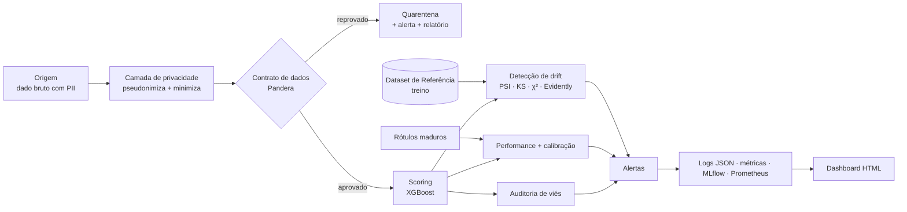
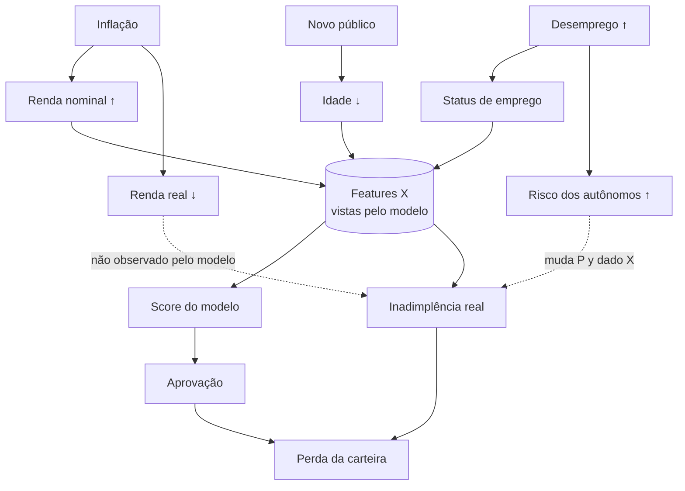

# Credit Scoring — Observabilidade, Drift, Qualidade de Dados e Governança

Tech Challenge — Fase 4 (MLET / Pós-Tech). Camada de **sustentação e confiabilidade** de um
modelo de Credit Scoring em produção: contrato de dados, simulação e detecção de drift,
observabilidade, governança/LGPD e análise causal da degradação.

> **Vídeo STAR (5 min):** (https://drive.google.com/file/d/1fjQW2ExuojU7dQJ-Dn5dgCWgoB3PLZ/view?usp=drive_link)
> **Integrantes:** Eduardo Merchiori

## Sumário

1. [Arquitetura](#arquitetura)
2. [Como executar](#como-executar)
3. [Etapa 1 — Contrato de dados](#etapa-1--contrato-de-dados)
4. [Etapa 2 — Simulação e detecção de drift](#etapa-2--simulação-e-detecção-de-drift)
5. [Etapa 3 — Observabilidade](#etapa-3--observabilidade)
6. [Etapa 4 — Governança e LGPD](#etapa-4--governança-e-lgpd)
7. [Análise causal da degradação](#análise-causal-da-degradação)
8. [Limitações](#limitações)

## Arquitetura



| Pasta / arquivo | Conteúdo |
|---|---|
| `src/privacy.py` | Pseudonimização (HMAC-SHA256) e minimização de PII |
| `src/contracts.py` | Contrato de dados (Pandera) e quarentena |
| `src/train.py`, `src/model.py` | Dataset de Referência e modelo baseline |
| `src/simulate_drift.py`, `src/datagen.py` | Lotes de produção com data drift e concept drift |
| `src/drift.py` | PSI, Kolmogorov-Smirnov, Qui-quadrado e relatórios Evidently |
| `src/monitor.py`, `src/observability.py` | Pipeline de monitoramento, métricas, alertas, MLflow, Prometheus |
| `src/fairness.py` | Auditoria de viés |
| `src/causal_analysis.py` | Análise causal por intervenção |
| `src/dashboard.py` | Dashboard HTML |
| `reports/` | **Evidências geradas** (dashboard, Evidently, contrato, drift, causal, model card) |
| `monitoring/` | Logs centralizados, histórico de métricas e alertas |
| `tests/` | Testes do contrato, do drift e da privacidade |
| `docs/roteiro_video_STAR.md` | Roteiro do vídeo |

## Como executar

Requer Python 3.11.

```bash
python -m venv .venv && source .venv/bin/activate      # Windows: .venv\Scripts\activate
pip install -r requirements.txt

export PII_HASH_SALT="$(openssl rand -hex 32)"          # segredo da pseudonimização (não versionar)

make all        # ou: python -m src.run_all
make test       # ou: python -m pytest -q
```

Depois abra `reports/dashboard.html` no navegador. Para o MLflow: `make mlflow-ui`
(http://127.0.0.1:5000, experimento `credit-monitoring`).

Etapas isoladas: `make train`, `make contract-demo`, `make simulate`, `make monitor`,
`make causal`, `make dashboard`.

### Dataset

Dataset **sintético** de concessão de crédito (20.000 linhas de referência + 6 lotes mensais de
5.000), gerado por `src/datagen.py` com semente fixa. A escolha é deliberada:

- nenhum dado pessoal real é usado ou versionado (privacy by design);
- o processo gerador é conhecido, o que permite simular **concept drift de verdade** (mudar
  `P(y|X)`), e não apenas deslocar colunas, e fazer análise causal por intervenção.

Separação exigida pelo desafio: `data/reference/` é o **Dataset de Referência** (treino) e
`data/production/` é o **Dataset de Análise/Produção** (onde o drift ocorre).

## Etapa 1 — Contrato de dados

Arquivo: `src/contracts.py` (Pandera). O contrato é a porta de entrada: um lote que viole
qualquer regra é **rejeitado por inteiro**, vai para `data/quarantine/`, gera alerta crítico e
relatório em `reports/contracts/`. Nada dele chega ao modelo.

| # | Regra | Motivo |
|---|---|---|
| R1 | `customer_hash` obrigatório, 32 caracteres, **sem duplicatas** | Idempotência e não contar o mesmo cliente duas vezes |
| R2 | `age` entre 18 e 100, sem nulos | Capacidade civil e plausibilidade |
| R3 | `monthly_income` entre 1 e 200.000, **sem nulos** | Variável mais importante do modelo |
| R4 | Faixas de `debt_to_income`, `credit_utilization` [0, 1], `employment_years`, etc. | Plausibilidade |
| R5 | Domínios fechados (`employment_status`, `housing_type`, `loan_term_months`, `gender`) | Categoria nova não entra sem revisão |
| R6 | `employment_years <= age - 14` (regra entre colunas) | Coerência de negócio |
| R7 | `strict=True`: nenhuma coluna fora do contrato | Barreira contra vazamento de PII bruta (`customer_id`, `birth_date`) |

Demonstração do bloqueio:

```bash
python -m src.demo_contract_failure
```

O script passa um lote limpo (aprovado) e um lote com renda nula e negativa, idade 15 e 130,
utilização 1.7, categoria desconhecida e duplicatas (bloqueado). No pipeline de monitoramento,
o mesmo acontece com o "reenvio corrompido" de agosto, que também traz uma coluna de PII bruta.

## Etapa 2 — Simulação e detecção de drift

### O que é simulado (`src/simulate_drift.py`)

Seis lotes mensais (2026-05 a 2026-10). A intensidade `t` cresce de 0 (igual à referência) a 1.

| Tipo | Mecanismo | Efeito |
|---|---|---|
| Data drift | Renda nominal inflacionada (até +60%) | `monthly_income`, `loan_amount` |
| Data drift | Desemprego de 6% para 20% | `employment_status`, `employment_years` |
| Data drift | Maior uso do limite de crédito | `credit_utilization` |
| Data drift | Novo perfil de cliente, mais jovem | `age` |
| Data drift | Mais atrasos recentes | `num_late_payments_12m` |
| Concept drift | Renda real corroída: a mesma renda nominal protege menos | `P(y\|X)` |
| Concept drift | Autônomos ficam mais arriscados | `P(y\|X)` |
| Concept drift | Utilização do limite pesa mais | `P(y\|X)` |
| Concept drift | Histórico (DTI, atrasos) perde poder preditivo | `P(y\|X)` |

As features chegam primeiro (`batch_*.csv`) e os rótulos reais depois (`labels_*.csv`), como
numa operação real em que a inadimplência demora a amadurecer.

### Como é detectado (`src/drift.py`)

| Teste | Onde | Limiar |
|---|---|---|
| PSI (decis da referência) | todas as features e o score | 0,10 atenção · 0,20 drift |
| Kolmogorov-Smirnov | numéricas | p < 0,05 |
| Qui-quadrado | categóricas | p < 0,05 |
| Evidently AI (`DataDriftPreset`, `ClassificationPreset`) | Referência × último lote | mesmos limiares |

Com 5.000 linhas por lote o KS rejeita H0 até para diferenças irrelevantes; por isso os
**alertas usam o PSI** (tamanho do efeito) e o p-valor fica como evidência complementar.

### Entregáveis

- `reports/evidently/evidently_data_drift_psi_<lote>.html` — relatório Evidently (PSI)
- `reports/evidently/evidently_data_drift_ks_<lote>.html` — relatório Evidently (KS/χ²)
- `reports/evidently/evidently_model_performance_<lote>.html` — qualidade da classificação
- `reports/drift/psi_por_lote.csv` e `reports/drift/drift_<lote>.csv` — tabelas dos testes

Resultado esperado: no primeiro mês nada dispara; a partir do 4º mês `credit_utilization`
cruza o limiar; no último mês cerca de metade das features está em drift (`credit_utilization`,
`age`, `monthly_income`, `employment_years`, `loan_amount`, `employment_status`), o AUC cai
abaixo do limite e a inadimplência entre aprovados aproximadamente dobra. Os números exatos
da sua execução estão em `reports/`.

## Etapa 3 — Observabilidade

Opção adotada: **MLflow para rastreamento + dashboard HTML próprio** (open source, sem
infraestrutura externa), com exportação opcional para Prometheus.

| Camada | Onde | Conteúdo |
|---|---|---|
| Logs centralizados | `monitoring/logs/pipeline.jsonl` | Um evento JSON por passo (ingestão, contrato, scoring, drift, alerta), sem PII |
| Métricas | `monitoring/metrics_history.jsonl` | Um registro por lote com todas as métricas abaixo |
| Alertas | `monitoring/alerts.jsonl` | Severidade, tipo, valor e limiar |
| Rastreamento | `mlruns/` (MLflow) | Um run por lote, com métricas e artefatos de drift |
| Dashboard | `reports/dashboard.html` | Visão consolidada |
| Prometheus | `monitoring/metrics.prom` | Gauges do último lote (textfile collector) |

### Métricas de saúde

| Grupo | Métrica | Para que serve |
|---|---|---|
| Pipeline | `status`, `contract_status` | Sucesso/falha de cada lote e do contrato |
| Pipeline | `rows_received`, `rows_ingested` | Volume recebido × volume que chegou ao modelo |
| Pipeline | `contract_failures` | Violações do contrato por lote |
| Infra | `latency_validation_ms`, `latency_scoring_ms`, `latency_total_ms`, `latency_per_1k_rows_ms` | Latência por etapa |
| Dados | `psi[feature]`, `ks_pvalue[feature]`, `n_drifted_features`, `drift_share` | Data drift |
| Modelo | `score_psi`, `approval_rate`, `mean_score` | Drift de predição (não depende de rótulo) |
| Modelo | `auc`, `ks`, `recall`, `precision`, `brier`, `bad_rate_approved` | Performance com rótulos maduros |
| Modelo | `default_rate - mean_score` | Calibração: o quanto o modelo subestima o risco |
| Governança | `fairness[grupo].disparate_impact` | Paridade de aprovação entre grupos |
| Alertas | `n_alerts` | Alertas por lote |

### Regras de alerta (`src/observability.py`, limiares em `src/config.py`)

| Tipo | Condição | Severidade |
|---|---|---|
| `data_contract` | Lote reprovado no contrato | crítico |
| `data_drift` | PSI da feature ≥ 0,20 | crítico |
| `prediction_drift` | PSI do score ≥ 0,20 | crítico |
| `concept_drift` | Inadimplência real − score médio previsto ≥ 4 p.p. | crítico |
| `performance_degradation` | Queda de AUC ≥ 0,05 vs. baseline | crítico |
| `retrain_recommended` | ≥ 30% das features em drift | crítico |
| `fairness` | Razão de impacto < 0,80 e pior que o baseline em 0,10 | atenção |
| `pipeline_failure` | Exceção inesperada em um lote | crítico |

### Runbook resumido

1. `data_contract`: lote fica em quarentena; acionar o time dono da origem; reprocessar só após correção.
2. `data_drift` isolado: investigar a causa (mudança de população × erro de origem); manter o modelo.
3. `concept_drift` ou `performance_degradation`: restringir a política (elevar o threshold e
   ampliar a revisão humana), retreinar com janela recente, validar em holdout temporal e
   promover com aprovação do comitê de modelos.
4. `fairness`: revisão pelo comitê de ética/risco antes do próximo ciclo.

## Etapa 4 — Governança e LGPD

> Proposta técnica para fins acadêmicos. Em um ambiente real, bases legais e prazos devem ser
> validados pelo Encarregado (DPO) e pelo jurídico.

### Inventário de dados

| Dado | Classificação | Tratamento neste projeto |
|---|---|---|
| `customer_id` | Dado pessoal (identificador direto) | Substituído por `customer_hash` (HMAC-SHA256 com salt secreto); o original nunca sai de `data/raw/` |
| `birth_date` | Dado pessoal | Generalizado para `age`; a data é descartada |
| `monthly_income`, dívidas, atrasos, empréstimo | Dado pessoal financeiro | Mantido: é o mínimo necessário para avaliar risco |
| `employment_status`, `housing_type` | Dado pessoal | Mantido, com domínio fechado |
| `gender` | Dado pessoal usado como atributo protegido | **Não é feature do modelo**; mantido só para auditoria de viés |
| Score e decisão | Dado pessoal derivado (decisão automatizada) | Armazenado com o hash, versão do modelo e do contrato |

Não há coleta de dados pessoais sensíveis (art. 5º, II): origem racial ou étnica, religião,
opinião política, saúde, vida sexual, genética ou biometria. Nome, CPF, e-mail, telefone e
endereço não entram na camada analítica (princípio da necessidade, art. 6º, III).

### Privacy by Design e by Default — o que está no código

| Medida | Onde |
|---|---|
| Pseudonimização antes de qualquer uso analítico (art. 13, §4º) | `src/privacy.py` |
| Salt fora do repositório, em variável de ambiente; sem ele a reidentificação é inviável | `.env.example`, `src/privacy.py` |
| Minimização: data de nascimento vira idade; identificador direto é removido | `src/privacy.py` |
| Barreira técnica: o contrato rejeita lotes com colunas fora do schema, inclusive PII bruta | `src/contracts.py` (R7) |
| Dado bruto e dados analíticos fora do versionamento | `.gitignore` (`data/`) |
| Logs e métricas só com agregados, sem identificadores ou valores individuais | `src/logging_utils.py`, `monitoring/` |
| Atributo protegido isolado das features | `src/config.py` (`AUDIT_COLUMNS`) |
| Dados de teste sempre sintéticos | `src/datagen.py`, `tests/` |

O dado pseudonimizado **continua sendo dado pessoal** enquanto o salt existir; a eliminação do
salt ao fim da retenção torna a reidentificação inviável por meios razoáveis (art. 12).

### Base legal

| Tratamento | Base legal (LGPD) |
|---|---|
| Análise e decisão de crédito | **Art. 7º, X — proteção do crédito**, em conjunto com a Lei 12.414/2011 (Cadastro Positivo) e o CDC |
| Coleta dos dados na proposta | Art. 7º, V — procedimentos preliminares a contrato, a pedido do titular |
| Guarda de registros da decisão | Art. 7º, II — obrigação legal/regulatória; art. 7º, VI — exercício regular de direitos |
| Monitoramento de drift e auditoria de viés | Art. 7º, IX — legítimo interesse, com dados pseudonimizados e teste de balanceamento documentado |

Consentimento não é a base adequada para a decisão de crédito: ele seria revogável a qualquer
momento e não é livre quando condiciona o acesso ao serviço.

### Decisão automatizada (art. 20)

- A decisão do modelo é `score >= threshold → negar / encaminhar para revisão humana`.
- O titular pode pedir **revisão** e **informações claras sobre os critérios** (art. 20, §1º).
- Para viabilizar isso, cada decisão guarda hash do cliente, score, threshold, versão do
  modelo e do contrato (`reports/model_card.json`), permitindo reproduzi-la.
- Próximo passo recomendado: anexar a cada negativa os principais fatores (ex.: SHAP).

### Plano de retenção (proposta)

| Dado | Prazo | Descarte |
|---|---|---|
| Dado bruto com PII (`data/raw/`) | Até 90 dias após a pseudonimização | Exclusão segura |
| Lotes em quarentena | 30 dias ou até a correção na origem | Exclusão |
| Propostas negadas | Até 5 anos, para atender revisão e defesa em processos | Exclusão ou anonimização |
| Propostas aprovadas e decisões | Vigência do contrato + 5 anos (prazos prescricionais e regulatórios) | Anonimização |
| Dataset de Referência pseudonimizado | Enquanto o modelo estiver em produção + 5 anos (auditoria) | Exclusão do salt e anonimização |
| Logs, métricas e alertas (sem PII) | 2 anos | Rotação automática |
| Salt da pseudonimização | Rotação anual; versões antigas só enquanto houver dado vinculado | Destruição no cofre de segredos |

Ao fim do tratamento, os dados são eliminados (arts. 15 e 16), salvo as hipóteses de
conservação do art. 16 (obrigação legal, exercício de direitos, uso anonimizado).

### Direitos do titular e segurança

- Direitos (art. 18): acesso, correção, anonimização/eliminação e informação sobre uso
  compartilhado, atendidos pelo `customer_hash` recalculado a partir do identificador.
- Segurança (art. 46): segredo fora do código, menor privilégio no acesso a `data/raw/`,
  criptografia em repouso e em trânsito no ambiente real, trilha de auditoria nos logs.
- Registro das operações (art. 37) e Relatório de Impacto (art. 38): recomendados, por se
  tratar de decisão automatizada em larga escala.
- Incidentes (art. 48): comunicação à ANPD e aos titulares conforme o plano de resposta.

### Mitigação de vieses

- `gender` não é feature. A paridade de aprovação é medida a cada lote
  (`src/fairness.py`), com alerta quando a razão de impacto cai abaixo de 0,80 (regra dos 4/5)
  e piora em relação ao baseline.
- **Viés conhecido e documentado:** `age` é feature e o baseline já aprova menos a faixa
  18–29 (razão de impacto ≈ 0,70). Parte disso reflete risco real (menos tempo de emprego),
  mas a disparidade está abaixo de 0,80 e precisa de justificativa de negócio ou mitigação:
  avaliar remover `age` e medir a perda de performance, calibrar por faixa, ou revisar
  manualmente as negativas próximas ao threshold.
- Risco de **proxy**: `employment_years` e `housing_type` são correlacionados com idade;
  remover `age` não elimina o efeito por si só.
- O drift pode piorar o viés (o novo público é mais jovem), por isso a auditoria roda em todo
  lote, não só no treino.

### Governança do modelo

- **Model card** versionado: `reports/model_card.json` (algoritmo, features, exclusões,
  threshold, métricas e viés do baseline, hash do dataset, versão do contrato).
- **Papéis:** dono do modelo (Risco), dono dos dados (Engenharia de Dados), Encarregado/DPO,
  comitê de modelos (aprova promoção e retreino).
- **Mudanças** no contrato ou nos limiares passam por pull request, com histórico semântico.

## Análise causal da degradação

Pergunta: **por que** o modelo degradou? Correlação entre "feature com drift" e "modelo pior"
não responde isso.



O modelo enxerga a **renda nominal**, que sobe, e conclui que o cliente está mais seguro; o
que determina a inadimplência é a **renda real**, que cai. A inflação é causa comum das duas
coisas e abre um caminho até `Y` que não passa pelo que o modelo observa.

### Método (`src/causal_analysis.py`)

Como o processo gerador é conhecido, fazemos **intervenções** (`do`): ligamos um mecanismo por
vez, com o restante no estado de referência e o modelo congelado, e medimos o efeito.

Resultado esperado (os valores da sua execução ficam em `reports/causal_analysis.md`):

| Cenário | AUC | Leitura |
|---|---|---|
| A. Baseline | ≈ 0,74 | Referência |
| B. Só data drift | não cai | `P(X)` mudou, mas a regra aprendida continua válida |
| C. Só concept drift | cai ≈ 0,05 | A regra aprendida deixou de valer |
| D. Ambos | cai ≈ 0,04–0,05 | Situação real do último mês |

Conclusões:

1. **A causa da degradação é o concept drift, não o data drift.** O data drift é o sintoma
   visível e o alerta precoce; sozinho não reduz o poder discriminante.
2. Os mecanismos que mais custam dinheiro são a **renda real corroída** e o **risco dos
   autônomos**: são os que mais aumentam a inadimplência entre aprovados e o risco subestimado.
3. A perda de sinal do histórico (DTI, atrasos) é a que mais reduz o AUC.
4. **Prescrição:** deflacionar a renda (feature em termos reais), retreinar com janela
   recente, recalibrar o threshold e monitorar calibração por segmento (`employment_status`).

Limite da análise: em dados reais o mecanismo gerador não é conhecido. A decomposição
exigiria rótulos maduros, reponderação por importância para isolar o efeito de `P(X)`,
variáveis macroeconômicas externas e hipóteses causais explícitas (DAG validado com o negócio).

## Limitações

- Dataset sintético: as relações são plausíveis, mas não substituem validação em dados reais.
- Rótulos chegam "instantaneamente" na simulação; na prática há atraso de meses e viés de
  seleção (só se observa a inadimplência de quem foi aprovado).
- O dashboard é estático, gerado a cada execução; em produção seria servido por Grafana/Datadog
  a partir das mesmas métricas.
